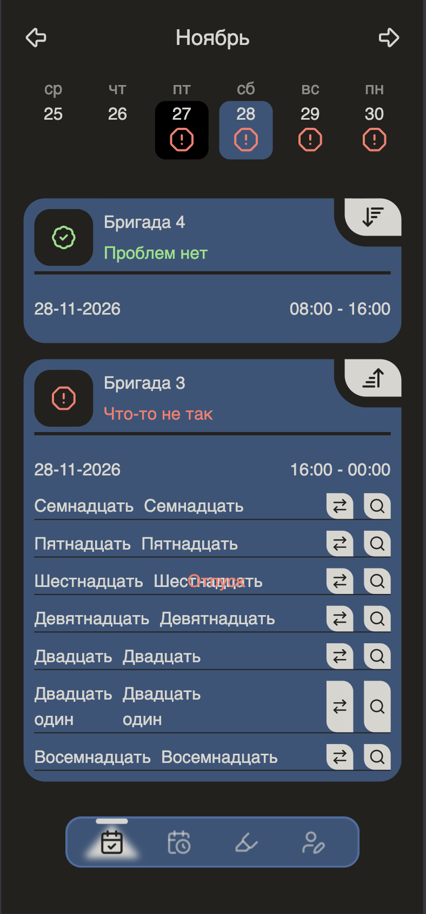

# OilNavigator

Есть демо-версия проекта, доступная на GitHub Pages:

- **Демо:** https://arturfox.github.io/OilNavigator/
- **Логин:** main@gmail.com
- **Пароль:** 123456789

## Суть проекта

OilNavigator - это веб и мобильное приложение для упрощения управления персоналом нефтеперерабатывающих предприятий.

Проект направлен на решение повседневных организационных задач начальников технологических установок и операторов, связанных с планированием смен, учетом отпусков, заменами сотрудников и контролем рабочего графика.

## Основные возможности

- **Планирование смен** — управление составом бригад и рабочим расписанием.
- **Учет отсутствий** — отображение отпусков, больничных и других причин отсутствия сотрудников.
- **Контроль кадровых дефицитов** — визуальное выявление нехватки персонала на сменах.

## Цель проекта

Сократить время, затрачиваемое начальниками установок на организационные задачи, автоматизировать управление сменным персоналом и сделать рабочие процессы более прозрачными и удобными.

Как бы пользовался (Начальник Установки)

1) Главная страница
    Заходя на главную страницу начальник установки сразу видит проблемы с составом персонала

2) Главная страница с открытым списком проблем
    Открыв список начальник установки сразу видит проблему что человек находится в данный момент в отпуске
    также могут быть ошибки (находится на обучении, на больгичном, в отпуске)
    (визуально пока плохо видно двльше исправлю мини баг)
