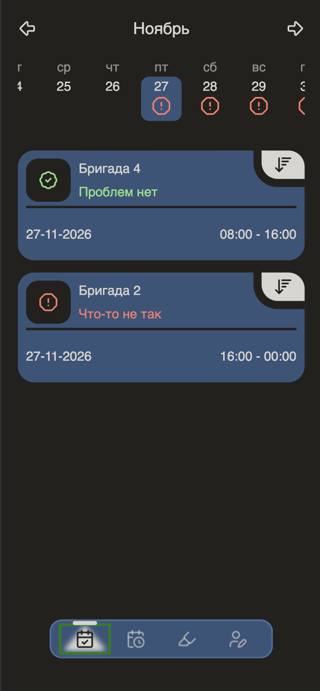
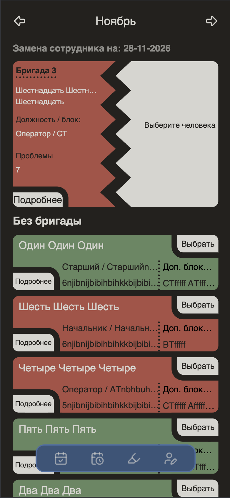
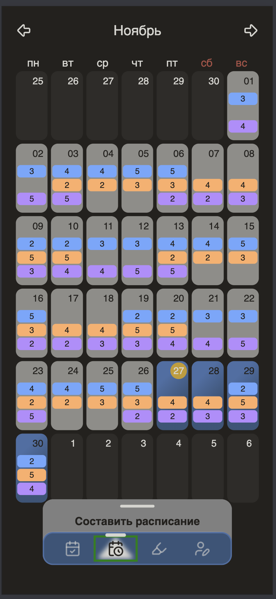
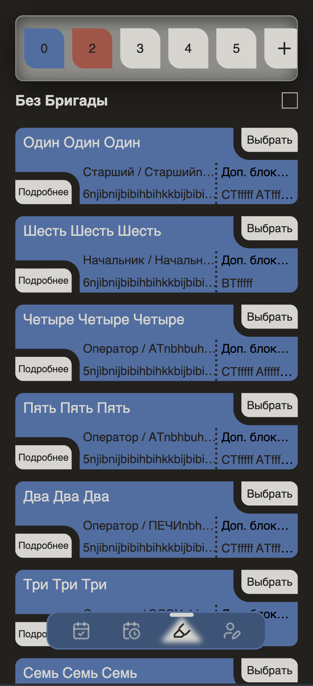
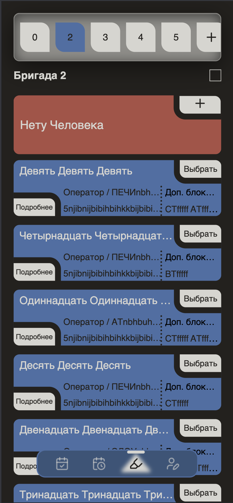
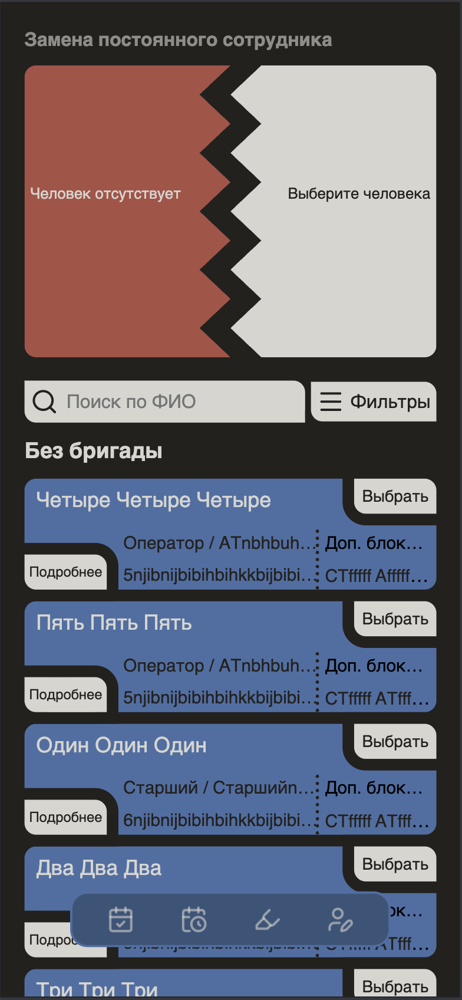

# OilNavigator

Есть демо-версия проекта, доступная на GitHub Pages:

- **Демо:** https://arturfox.github.io/OilNavigator/
- **Логин:** main@gmail.com
- **Пароль:** 123456789

## Суть проекта

OilNavigator - это веб и мобильное приложение для упрощения управления персоналом нефтеперерабатывающих предприятий.

Проект направлен на решение повседневных организационных задач начальников технологических установок и операторов, связанных с планированием смен, учетом отпусков, заменами сотрудников и контролем рабочего графика.

## Основные возможности

- **Планирование смен** — управление составом бригад и рабочим расписанием.
- **Учет отсутствий** — отображение отпусков, больничных и других причин отсутствия сотрудников.
- **Контроль кадровых дефицитов** — визуальное выявление нехватки персонала на сменах.

## Цель проекта

Сократить время, затрачиваемое начальниками установок на организационные задачи, автоматизировать управление сменным персоналом и сделать рабочие процессы более прозрачными и удобными.

Как бы пользовался (Начальник Установки)

1) Главная страница

    Заходя на главную страницу начальник установки сразу видит проблемы с составом персонала

2) Главная страница с открытым списком проблем

    Открыв список начальник установки сразу видит проблему что человек находится в данный момент в отпуске
    также могут быть ошибки (находится на обучении, на больгичном, в отпуске)
    (визуально пока плохо видно двльше исправлю мини баг)

3) Страница замены

    Нажав на кнопку замены, начальник переходит на страницу замены
    Где сразу видно кто может выйти на замену именно НА СЕГОДНЯШНИЙ ДЕНЬ

4) Страница календаря

    Где начальник в дальнейшем сможет увидить и отфильтровать конкретную бриаду, человека 
    и сразу будет видно когда он работатет когда в отпук уходит на обучение и тд

    Также здесь будет составление расписания для бригады

5) Страница основного состава для бригады

    Это страница где начальнк выберает костяк людей в бригаду
    Если даже человек в данный момент по тем или иным причинам не находится в этой бриагаде
    После выхода из больничного и тд он вернется в эту бригаду

    Если не хватает человека то можно добавить человека

6) Страница для замены основного состава

    Тут просто начальник выберает человека в бригаду 

